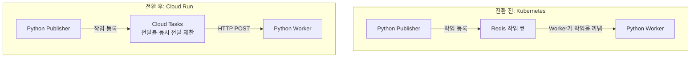

얼굴 생성 서비스를 점검할 당시, 생성 요청을 보내는 Python Publisher와 실제 생성 작업을 수행하는 Worker는 Kubernetes에서 실행되고 있었습니다. 서비스는 아직 정식 오픈 전이었지만, 사용하지 않는 동안에도 자원이 유지되어 비용이 발생했습니다. 소규모 조직에서 클러스터를 관리하는 부담도 있어, 현재 구성을 계속 유지하는 것이 적절한지 살펴보았습니다.

## 서비스 단계에 맞춘 전환

Kubernetes를 유지할 이유도 있었습니다. 다른 서비스까지 같은 환경에서 운영한다면 관리 방식을 통일할 수 있고, 나중에 클라우드를 이전할 때의 이점도 고려할 수 있었습니다. 다만 당시에는 얼굴 생성 처리만 Kubernetes를 사용하고 있었습니다. 이 서비스 하나를 위해 클러스터를 유지하는 상황에서는 관리 부담을 줄이는 편이 낫겠다고 판단했습니다.

대안으로 검토한 것은 Cloud Run이었습니다. 요청에 따라 확장할 수 있고 요청 기반 과금 방식을 제공해, 사용량이 적은 단계에서 자원을 계속 유지하는 부담을 줄일 수 있다고 보았습니다. [Cloud Run 과금 방식](https://docs.cloud.google.com/run/docs/configuring/billing-settings)

Cloud Run으로 옮기면 콜드 스타트로 요청 처리가 늦어질 수 있다는 점도 고려했습니다. 예를 들어 실행 중인 인스턴스가 없는 상태에서 얼굴 생성 요청을 받으면, 작업에 들어가기 전에 새 인스턴스를 시작하고 애플리케이션을 준비하는 시간이 추가됩니다.

다만 얼굴 생성 자체가 오래 걸리는 작업이어서 당시에는 이 대기 시간을 감수할 수 있다고 판단했습니다. 이후 Publisher와 Worker, 필요한 IAM을 Terraform으로 구성하고 기존 Kubernetes 자원을 정리했습니다.

요청을 Worker에 전달하는 방식도 바꿨습니다. 기존에는 Publisher가 Redis 큐에 작업을 넣고, Worker가 큐에서 작업을 꺼내 처리했습니다. 전환 후에는 Publisher가 Cloud Tasks에 작업을 등록하고, Cloud Tasks가 Cloud Run Worker를 HTTP POST로 호출하도록 구성했습니다. Worker도 큐를 지켜보는 프로세스에서 HTTP 요청을 받는 서버로 바꿨습니다.

전후 구조는 다음과 같습니다.

## 큐에서 Worker 호출량 조절하기

Cloud Tasks에서 작업 전달 속도와 동시 전달량을 조절하도록 설정했습니다. 요청이 한꺼번에 들어와도 Worker로 모두 보내지 않고, 큐에 대기시킨 뒤 설정한 한도에 맞춰 전달하도록 했습니다.

전달률과 동시 전달 제한은 Terraform으로 관리했습니다.

## CPU를 늘리면 생성 시간이 얼마나 줄어들까

콜드 스타트는 감수하더라도 생성 작업 자체의 시간을 줄일 방법이 있을지 살펴보았습니다. 솔루션 문서를 읽고 멀티스레딩을 지원하는 것으로 이해했기 때문에, CPU를 늘리면 처리 시간이 짧아질 수 있겠다고 생각했습니다. 이를 확인하기 위해 사양을 바꿔가며 생성 시간을 측정했습니다.

| CPU | 메모리 | 생성 시간 |
| :--- | :--- | ---: |
| 2 vCPU | 1 GiB | 약 87초 |
| 4 vCPU | 2 GiB | 약 50초 |
| 6 vCPU | 4 GiB | 약 37초 |
| 8 vCPU | 4 GiB | 약 30초 |

CPU를 늘릴수록 생성 시간은 짧아졌지만, 같은 수의 코어를 추가해도 줄어드는 시간은 달랐습니다. 4코어에서 6코어로 늘렸을 때는 약 13초가 줄었고, 6코어에서 8코어로 늘렸을 때는 약 7초가 줄었습니다. 추가 자원에 비해 시간 단축 폭이 작아지는 것을 보고, 사용자의 대기 시간과 자원 사용을 함께 고려해 6 vCPU, 4 GiB를 선택했습니다.

## 전환과 함께 정리한 자원

얼굴 생성 서비스를 옮기는 작업과 함께 정적 웹 전달 구성도 정리했습니다. 사용하지 않는 자원을 제거하고 DB 사양을 조정하는 작업까지 마친 뒤, 전체 GCP 일 사용료는 약 70% 감소했습니다.
