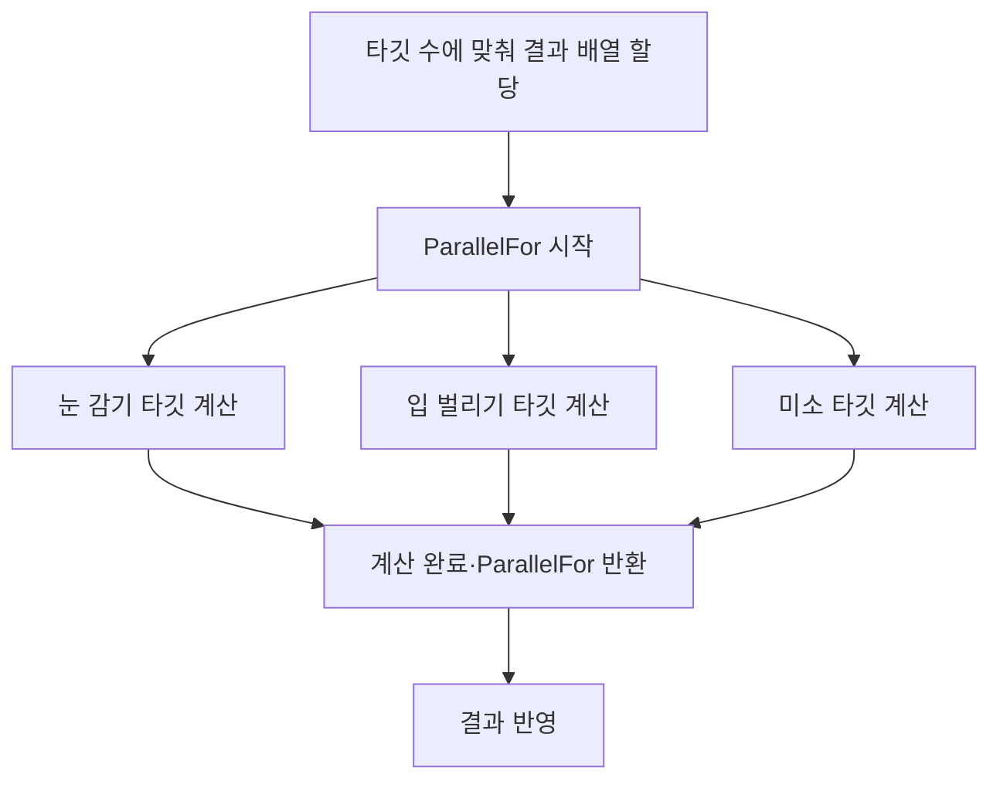

런타임에 생성한 얼굴을 Unreal Engine의 SkeletalMesh로 변환하는 기능을 개발하면서, 변환 중 화면이 잠시 멈추는 문제가 있었습니다. 생성 결과를 엔진에서 사용할 메시로 만드는 과정에는 여러 처리가 포함되어 있어, 어느 구간에서 시간이 오래 걸리는지 먼저 확인했습니다.

Unreal Insights로 처리 구간을 살펴보니 얼굴 형태를 바꾸는 MorphTarget 계산에서 병목이 나타났습니다. 이 계산을 여러 스레드로 나누어 처리할 수 있을지 살펴본 뒤, 서로 독립적으로 계산할 수 있는 부분을 병렬화하기로 했습니다.

## 계산과 결과 반영 분리

병렬화에는 Unreal Engine의 `ParallelFor`를 사용했습니다. 여러 스레드에서 반복 작업을 수행하는 함수이므로, 작업들이 서로 영향을 주지 않도록 계산 범위를 나누어야 했습니다. 처리할 타깃 수에 맞춰 결과 배열을 먼저 할당하고, 독립 계산을 병렬로 수행한 뒤 결과를 반영하도록 구성했습니다. [Epic ParallelFor 문서](https://dev.epicgames.com/documentation/en-us/unreal-engine/API/Runtime/Core/ParallelFor)

눈 감기, 입 벌리기, 미소 타깃의 데이터를 계산하는 경우를 예로 들 수 있습니다. 한 타깃의 계산이 다른 타깃의 결과를 필요로 하지 않는다면, 세 계산을 순서대로 기다리는 대신 함께 처리할 수 있습니다. 각 계산이 끝나면 준비해 둔 결과 배열에 모으고, 모두 완료된 뒤 메시를 구성하는 데 사용합니다.

세 타깃을 예로 들면 처리 순서는 다음과 같습니다.

`ParallelFor`가 계산을 마치고 반환되면 결과를 반영하도록 했습니다. 처리 시간도 호출이 반환된 뒤 타이머를 종료해 기록했습니다.

## 처리 결과와 측정

변경 후에는 변환 과정에서 발생하던 프리징을 해소했습니다. 147개 MorphTarget을 처리하면서 남긴 로그에는 다음과 같은 시간이 기록되어 있습니다.

| 방식 | 1회 | 2회 | 3회 | 평균 |
| :--- | ---: | ---: | ---: | ---: |
| 비병렬 | 30.044ms | 30.052ms | 30.845ms | 30.314ms |
| ParallelFor | 5.324ms | 5.533ms | 5.033ms | 5.297ms |
