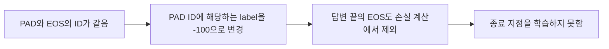

캐릭터와 대화하는 서비스 Toon Chat에서 LLM 학습과 서빙을 담당했습니다. 여러 차례 오가는 대화의 맥락을 모델이 학습할 수 있도록 멀티턴 데이터를 사용했는데, 학습한 모델이 자신의 답변을 끝낸 뒤에도 다음 사용자와 Assistant의 대화까지 계속 만들어내는 문제가 생겼습니다.

출력 형태를 예로 들면 다음과 같습니다.

```text
사용자 입력
User: 오늘 뭐 했어?

기대한 모델 출력
Assistant: 오늘은 훈련을 했어.

문제가 생긴 출력 형태
Assistant: 오늘은 훈련을 했어.
User: 많이 힘들었어?
Assistant: 조금 힘들었지만 괜찮아.
```

모델이 자신의 답변에서 멈추지 않고, 사용자가 아직 보내지 않은 질문까지 만들어 대화를 이어가는 형태였습니다.

출력에서 무슨 일이 일어나는지 확인하려고 생성 결과 텐서의 토큰 ID를 하나씩 디코딩했습니다. 그 과정에서 문장의 끝을 나타내는 EOS가 나오지 않는 것을 확인했고, 학습 과정에서 이 토큰이 어떻게 처리되는지 살펴보기로 했습니다.

## EOS가 학습에서 제외된 이유

학습에 사용한 TRL의 `DataCollatorForCompletionOnlyLM` 코드를 따라가다가, 입력 토큰으로 학습용 label을 만드는 부분을 확인했습니다. 여기서는 패딩을 학습하지 않도록 PAD에 해당하는 label을 `-100`으로 바꾸고 있었습니다. 그런데 제가 사용한 tokenizer에서는 `pad_token_id`와 `eos_token_id`가 같았습니다.

문제를 설명하기 위해 PR에 첨부한 코드의 핵심은 다음 한 줄입니다.

```python
labels[labels == self.tokenizer.pad_token_id] = -100
```

출처: [TRL PR #988](https://github.com/huggingface/trl/pull/988)에 첨부한 당시 처리 코드.

이 코드는 PAD의 ID와 같은 값을 모두 손실 계산에서 제외합니다. EOS도 같은 ID를 사용하고 있었으므로 답변 끝의 EOS까지 함께 제외되고 있었고, 모델은 답변이 끝나는 지점을 학습하지 못하고 있었습니다.

예를 들어 답변 뒤에 EOS와 PAD가 붙어 있다면, 두 토큰의 ID가 같아 아래처럼 모두 제외됩니다.

| 토큰의 역할 | 학습 label 처리 |
| :--- | :--- |
| 답변 내용 | 유지 |
| 답변 끝의 EOS | `-100`으로 변경 |
| 길이를 맞추는 PAD | `-100`으로 변경 |

확인한 원인을 정리하면 다음과 같습니다.



프로젝트에서는 PAD에 EOS와 다른 UNK 토큰을 지정하고 모델을 다시 학습했습니다. 이후 생성 결과에 EOS가 나타났고, Assistant의 답변도 정상적으로 끝났습니다.

## 같은 설정을 발견하면 경고하도록

프로젝트의 문제는 해결했지만, 같은 토큰 설정으로 멀티턴 학습을 하는 다른 사용자도 비슷한 문제를 겪을 수 있었습니다. 그래서 TRL에서 이 설정을 감지해 경고를 표시하도록 PR을 작성했습니다.

모델마다 사용할 수 있는 PAD, UNK, BOS 토큰이 달라, 라이브러리에서 PAD를 일괄 변경하기는 어렵다고 판단했습니다. 따라서 멀티턴 학습에서 PAD와 EOS의 ID가 같은 경우를 알리고, 사용자가 자신의 모델에 맞게 설정을 조정하도록 했습니다. 이 PR은 2023년 11월 14일 병합되었습니다. [TRL PR #988](https://github.com/huggingface/trl/pull/988)
