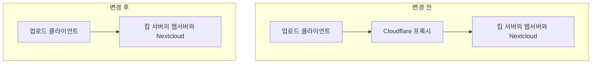

라즈베리파이에 Nextcloud를 올려 개인 클라우드 스토리지로 사용했습니다. 집에서 운영하는 서버의 IP가 직접 노출되는 것을 줄이려고 Cloudflare 프록시를 앞에 두었는데, 평소에는 문제없이 쓰다가 큰 파일을 업로드할 때 실패하는 현상이 생겼습니다. 특히 100MB를 넘는 파일에서 문제가 나타났고, 응답은 `413`이었습니다.

파일을 받는 서비스가 Nextcloud였기 때문에 처음에는 Nextcloud나 웹서버의 업로드 설정을 의심했습니다. 관련 설정을 찾아 변경하고 nginx, Apache와 Nextcloud 컨테이너의 로그를 확인했지만 오류가 계속됐습니다. 애플리케이션에서 원인을 찾으려는데 해당 오류를 설명해 줄 로그가 보이지 않아, 설정을 바꾸는 것만으로는 더 진행하기 어려웠습니다.

## 파일을 받기 전에 거치는 곳

조사하던 중 Cloudflare 무료 플랜을 사용하고 있다면 프록시를 해제해 보라는 댓글을 발견했습니다. 제가 확인하고 있던 것은 Nextcloud와 웹서버였지만, 업로드 요청이 처음 도착하는 곳은 Cloudflare였습니다. Nextcloud가 파일을 받을 준비가 되어 있어도 그 앞에서 요청을 거절하면 업로드는 실패할 수 있었습니다.

Cloudflare의 크기 제한은 업로드 요청 본문에 적용됩니다. 따라서 Nextcloud와 웹서버의 허용 크기를 늘리는 것과 Cloudflare를 통과할 수 있는지는 별개의 문제입니다. 앞단에서 요청을 거절했다면 Nextcloud까지 그 요청이 도착하지 않을 수 있으므로, Nextcloud의 오류 로그만 살펴봐서는 원인을 찾기 어렵습니다. [Cloudflare의 413 안내](https://developers.cloudflare.com/support/troubleshooting/http-status-codes/4xx-client-error/error-413/)

요청이 지나가는 경로를 놓고 보면 바꿔야 할 지점이 분명해집니다.

## 프록시를 거치지 않도록 변경

Cloudflare 프록시를 제거한 뒤에는 이전에 실패하던 대용량 파일 업로드가 가능해졌습니다.

## 파일 크기와 요청 크기는 다르다

Nextcloud 문서를 보면 파일을 작은 조각으로 나누어 보내는 청크 업로드도 지원합니다. Cloudflare가 제한하는 것은 개별 요청의 크기이므로, 이론상 청크를 제한보다 작게 보내면 프록시를 유지하면서도 대용량 파일을 업로드할 수 있을 것 같습니다. [Nextcloud의 대용량 업로드 문서](https://docs.nextcloud.com/server/latest/admin_manual/configuration_files/big_file_upload_configuration.html)

청크가 작아지면 실패한 조각을 다시 보내는 부담은 줄어드는 대신, 요청 수가 늘어 업로드 속도나 서버 부담에 영향을 줄 수도 있을 것 같습니다. 마지막에 청크를 합치는 작업도 필요하므로, 이 방식을 사용한다면 청크 크기를 줄였을 때 실제 업로드가 가능한지와 처리 부담이 어떻게 달라지는지를 함께 확인해 보면 좋겠습니다.

