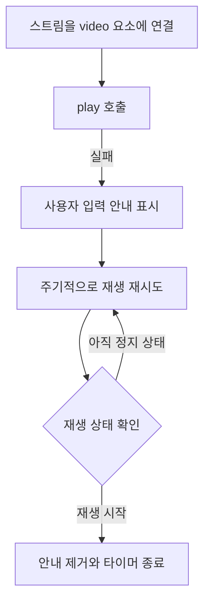

WebRTC로 사용자들이 화상 토론을 하는 서비스를 개발하면서 영상이 간헐적으로 나오지 않는 문제를 겪었습니다. 항상 재현되는 오류가 아니어서, 연결이 실패한 것인지 클라이언트가 받은 영상을 표시하지 못하는 것인지부터 구분할 필요가 있었습니다. 브라우저 개발자 도구의 네트워크 탭에서는 일반적인 HTTP 요청처럼 RTC 통신을 따라가기 어려웠고, Wireshark로 제 PC에 상대방 IP의 패킷이 도착하는지 확인했습니다.

패킷이 도착하는 것을 확인한 뒤, 클라이언트의 영상 연결과 재생 처리로 조사 범위를 좁혔습니다. 다만 패킷 도착 여부와 화면 재생 여부는 서로 다른 확인 대상입니다. 패킷이 도착해도 미디어 스트림을 video 요소에 연결하지 못할 수 있고, 연결이 되어 있어도 브라우저가 재생 요청을 허용하지 않을 수 있습니다. 화면에 영상이 없다는 같은 증상을 보고도 확인해야 할 지점이 여러 곳인 셈입니다.

## 연결된 영상이 자동으로 재생되지는 않는다

클라이언트에서 다룬 문제 중 하나는 브라우저의 자동재생 제한이었습니다. Chrome은 음소거된 영상의 자동재생을 허용하지만, 소리가 있는 미디어에는 사용자 상호작용이나 미디어 참여도 같은 조건을 적용합니다. HTML의 `autoplay` 속성뿐 아니라 JavaScript에서 호출한 `play()`에도 이 정책이 적용됩니다. [Chrome 자동재생 정책](https://developer.chrome.com/blog/autoplay/)

당시 기억으로는 토론 페이지에서 새로고침하면 영상이 자동으로 재생되지 않았지만, 메인 화면에서 토론 주제를 클릭해 들어오면 재생됐습니다. 같은 토론 페이지인데도 진입 경로에 따라 결과가 달랐던 것입니다.

메인 화면에서 들어오는 경로에는 사용자의 클릭이 있었습니다. 실제 코드도 카드 클릭 시 React Router로 토론 페이지에 이동하는 구조였습니다. 반면 새로고침은 문서를 다시 불러오므로, 페이지 안에서 다시 상호작용하기 전에 소리가 있는 영상의 재생을 요청할 수 있습니다. 이 차이는 사용자 상호작용을 자동재생 허용 조건으로 사용하는 Chrome 정책과 맞아떨어집니다. Chrome의 공식 설명에도 홈페이지에서 콘텐츠를 클릭해 들어오면 해당 도메인과의 상호작용으로 자동재생이 허용되는 예가 있습니다. [Chrome의 진입 경로별 자동재생 예시](https://developer.chrome.com/blog/autoplay/#examples)

Chrome 정책의 조건들은 모두 동시에 충족해야 하는 체크리스트가 아닙니다. 미디어 참여 지수는 데스크톱에서 적용되는 조건이고, iframe에 대한 권한 위임은 상위 프레임이 가진 자동재생 권한을 전달하는 방식입니다. 따라서 구현에서는 조건을 추측해 재생 성공을 가정하기보다, 실제 재생 요청의 결과를 확인하는 편이 명확합니다.

## 재생 실패를 사용자에게 보여주기

당시 클라이언트에서는 OpenVidu의 `addVideoElement()`로 스트림과 video 요소를 연결하고 `play()`를 호출했습니다. 재생 요청이 실패하면 클릭이나 키보드 입력이 필요하다는 토스트를 띄웠고, 200ms 간격으로 재생을 다시 시도했습니다. video 요소의 `paused`가 false가 되면 타이머를 멈추고 안내를 지웠습니다.

영상이 보이지 않는 상태에서 사용자가 아무 정보 없이 기다리게 하는 대신, 재생을 위해 필요한 조작을 안내하는 방식으로 바꾼 것입니다. 구현은 클릭 이벤트에서 바로 `play()`를 호출하는 형태가 아니라, 사용자의 입력을 안내하면서 재생을 반복 시도하는 형태였습니다.

## 재생 실패 안내를 돌아보며

지금 코드를 돌아보면, 재생 요청이 실패했을 때 오류의 종류를 구분하지 않고 사용자 입력을 안내하고 있었습니다. 하지만 `play()`가 반환하는 Promise는 자동재생이 허용되지 않았을 때의 `NotAllowedError`뿐 아니라, 지원하지 않는 미디어 소스 같은 다른 이유로도 거절될 수 있습니다. 입력이 필요한 상황과 입력만으로 해결되지 않는 상황에 같은 안내를 보여주고 있었던 셈입니다. [play()의 반환값과 오류](https://developer.mozilla.org/en-US/docs/Web/API/HTMLMediaElement/play)

재시도하는 `play()`의 Promise에도 실패 처리가 빠져 있었습니다. 지금 다시 구현한다면 실패 원인에 따라 안내를 나누고, 자동재생이 막힌 경우에는 사용자가 재생 버튼을 눌러 다시 요청하도록 바꾸겠습니다. 주기적으로 재생을 시도하기보다 사용자의 조작과 재생 요청을 직접 연결하고, 그 요청의 성공 여부까지 확인하는 쪽이 당시의 안내 의도를 더 분명하게 전달할 것 같습니다.
